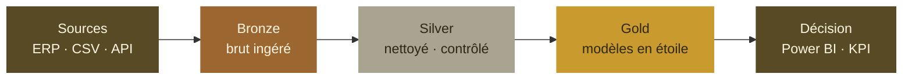

<!-- Profile README @filou337 — octobre 2026 — lisible en 10 secondes, détails repliables -->

  

  <b>Je transforme des données brutes en modèles fiables, testés et documentés, prêts pour la décision.</b>

  
  
  
  

  <a href="#-en-bref">En bref</a> ·
  <a href="#-comment-je-travaille-la-donnée">Pipeline</a> ·
  <a href="#-stack">Stack</a> ·
  <a href="#-expérience">Expérience</a> ·
  <a href="#-projets">Projets</a> ·
  <a href="#-ce-que-je-recherche">Recherche</a>

---

## 👋 En bref

| | |
|---|---|
| **Rôles visés** | Analytics Engineer · Data Engineer · Consultant Data · Data / Business Analyst |
| **Contrat** | CDI ou CDD, disponible dès maintenant |
| **Lieu** | Île-de-France, hybride ou sur site |
| **Formation** | Master Big Data & Business Intelligence, Université Sorbonne Paris Nord (2026) |
| **Cœur de stack** | Azure Data Factory · Databricks · PySpark · SQL · Power BI · Azure DevOps |
| **Langues** | Français (C2) · Anglais (B2) · Espagnol (A2) |

---

## 🧱 Comment je travaille la donnée

À chaque couche : **tests de qualité**, **documentation** et **versioning** (Git, CI/CD).

---

## 🧰 Stack

| Étape | Outils |
|---|---|
| **Ingestion** |   |
| **Transformation** |      |
| **Modélisation & BI** |    |
| **Qualité & livraison** |     |

---

## 💼 Expérience

**Data Analyst (stage)** · Colas Digital Solutions · *mars – sept. 2026*
> Ingestion et transformation en architecture Bronze / Silver / Gold, modèles en étoile et dashboards Power BI, gouvernance et qualité des données, CI/CD sous Azure DevOps, conduite d'un projet d'IA agentique.

Voir le détail

- Recueil des besoins métier et traduction en règles de gestion, modèles de données et reporting
- Ingestion, nettoyage et transformation avec ADF, Databricks, PySpark et Scala
- Contrôles de cohérence et de complétude, documentation, suivi des évolutions dans Azure DevOps
- Gouvernance des données : règles de qualité, référentiels et documentation
- Modèles en étoile et dashboards Power BI (Power Query, DAX), audits Measure Killer
- Travail en sprints Agile avec les équipes métier et techniques

**Consultant Data (stage)** · DrNIKO / TECHNIKO · *nov. 2025 – févr. 2026*
> Cadrage des besoins clients, benchmarks et grilles de notation de solutions d'IA médicale, recommandations et supports de synthèse.

---

## 📌 Projets

> 🛠️ **Refonte en cours.** Mes dépôts sont en train d'être reconstruits autour de l'**analytics engineering** : transformations modélisées, tests de qualité, documentation des modèles et couches prêtes pour la BI.

<!-- Quand les dépôts sont prêts, remplacer l'encart par ce tableau :
| Projet | Ce qu'il montre | Stack |
|---|---|---|
| [nom-du-repo](https://github.com/filou337/nom-du-repo) | Une phrase sur le résultat | `SQL` `PySpark` `Power BI` |
-->

---

## 🏆 Réalisations

- 🎓 **Master Big Data & Business Intelligence**, Université Sorbonne Paris Nord (2026)
- 🥇 **Coach au Hackathon Colas** (mai 2026) : l'équipe ESTP / EFREI accompagnée a remporté la **1re place**
- 🤝 **Bénévole chez Linkee** : actions solidaires contre la précarité alimentaire

---

## 🎯 Ce que je recherche

Un poste où je peux **construire les modèles de données entre l'ingestion et la BI**, sur une stack cloud (Azure, Databricks) avec de vraies pratiques de **CI/CD**, et transformer des besoins métier en **indicateurs fiables**.

Ma façon de travailler

- **Business first** : comprendre le contexte, clarifier le problème, définir des KPI simples
- **Qualité dès la conception** : tests, contrôles de cohérence et documentation intégrés aux modèles
- **Reproductibilité** : Git, CI/CD, structure de projet propre, README détaillés
- **Pédagogie** : des résultats compréhensibles et des recommandations actionnables
- **Éthique** : attention aux sources, aux biais et à l'usage responsable de l'IA

Stats GitHub

 

<picture>
  <source media="(prefers-color-scheme: dark)" srcset="https://github-readme-stats.vercel.app/api/top-langs/?username=filou337&layout=compact&langs_count=8&theme=github_dark&bg_color=00000000">
  
</picture>

---

  Mis à jour en octobre 2026 · Bobigny, Île-de-France

